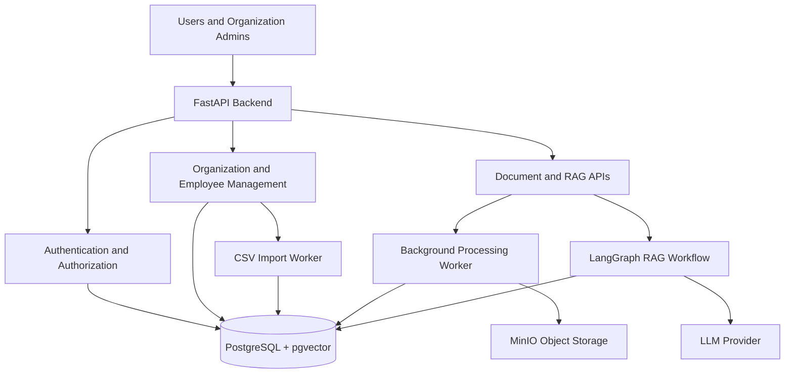

# High-Level Design (HLD)
## Enterprise AI Knowledge & Operations Platform

### 1. Project Overview

The Enterprise AI Knowledge & Operations Platform is a multi-tenant application that allows organizations to securely manage employees, upload documents, and retrieve answers from their internal knowledge using Retrieval-Augmented Generation (RAG).

Each organization can access only its own users, documents, and information.

### 2. Objectives

- Support multiple organizations on one platform.
- Provide secure authentication and role-based access control.
- Support employee onboarding through CSV upload.
- Allow organizations to upload and process documents.
- Provide AI-powered question answering using RAG.
- Maintain tenant-level data isolation.

### 3. High-Level Architecture

### 4. Main Components

- **FastAPI:** Exposes APIs and handles requests.
- **Authentication and Authorization:** Verifies users and their permissions.
- **PostgreSQL:** Stores organizations, users, memberships, documents, and application data.
- **pgvector:** Stores document embeddings for semantic retrieval.
- **LangGraph:** Orchestrates the RAG workflow.
- **LLM Provider:** Generates answers using retrieved context.
- **Background Workers:** Handle CSV imports and document processing asynchronously.
- **MinIO:** Stores uploaded files locally; AWS S3 can replace it in production.

### 5. Multi-Tenant Architecture

The platform uses a **shared database with logical tenant isolation**.

Each organization has a unique `organization_id`. Organization-owned records are associated with that ID, and the backend checks organization membership and permissions before allowing access.

Main entities:

- `organizations` — organization details.
- `users` — user account details.
- `organization_memberships` — links users to organizations and assigns roles.
- `documents` — uploaded document metadata and organization ownership.
- `invitations` — employee onboarding invitations.

Roles include Platform Admin, Organization Admin, and Employee.

### 6. Employee Onboarding Flow

1. Platform Admin creates an organization.
2. The system invites the first Organization Admin.
3. The Organization Admin uploads a CSV containing employee details.
4. The backend validates the file and queues a background import job.
5. The worker processes valid records and reports failures.
6. Employees receive invitations to activate their accounts.

The backend determines the organization from the authenticated admin's authorized membership, rather than trusting an organization ID supplied by the CSV.

### 7. Document and RAG Flow

1. An authorized user uploads a document.
2. The backend validates the file and stores it in MinIO.
3. A background worker extracts text and splits it into chunks.
4. The system generates embeddings and stores them in pgvector.
5. A user asks a question.
6. The retrieval workflow searches only documents the user is authorized to access.
7. The LLM generates an answer using the retrieved context.
8. The API returns the answer to the user.

### 8. Security and Reliability

- JWT-based authentication.
- Password hashing using Argon2.
- Role-based access control.
- Organization-level data isolation across APIs, database queries, and RAG retrieval.
- Input validation and secure file-upload handling.
- Background job retries and structured error logging.
- Automated tests for authentication, permissions, and tenant isolation.

### 9. Technology Stack

| Area | Technology |
|---|---|
| Backend | Python 3.13, FastAPI |
| Validation | Pydantic v2 |
| Database | PostgreSQL, SQLAlchemy 2 async, Alembic |
| Vector Search | pgvector |
| AI Workflow | LangGraph, LangChain |
| Embeddings | Sentence Transformers |
| Background Jobs | Celery, Redis |
| File Storage | MinIO |
| Testing | Pytest, HTTPX |
| Deployment | Docker Compose |
| Future Cloud | AWS ECS, RDS, S3, ElastiCache, CloudWatch |

### 10. Future Enhancements

- AWS deployment.
- Single sign-on (SSO).
- Bulk employee imports with richer validation reports.
- Advanced RAG evaluation and monitoring.
- Organization-level usage and audit reports.

