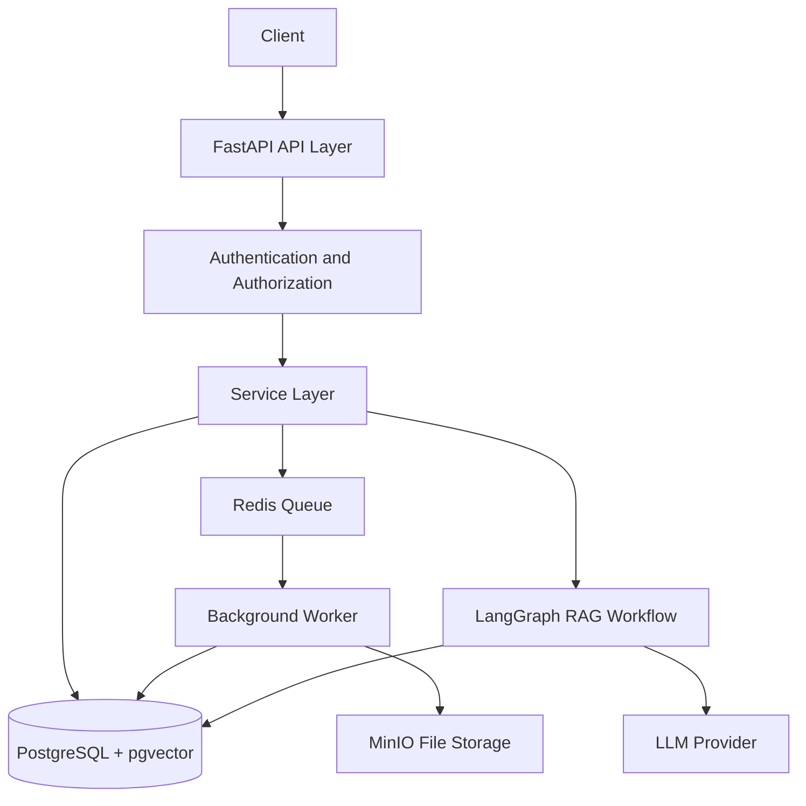

# Low-Level Design (LLD)
## Enterprise AI Knowledge & Operations Platform

### 1. Purpose

This document describes how the platform's main components will be implemented, including authentication, organization management, employee onboarding, document processing, and RAG-based question answering.

### 2. Architecture Overview

### 3. Main Modules

| Module | Responsibility |
|---|---|
| Authentication | Login, token creation, refresh, logout |
| Organization | Create and manage organizations |
| User Management | Manage accounts and organization memberships |
| Employee Import | Validate and process employee CSV files |
| Document Management | Upload and manage documents |
| Ingestion | Extract text, split chunks, create embeddings |
| RAG | Retrieve authorized context and generate answers |
| Background Jobs | Process imports and documents asynchronously |
| Observability | Logs, metrics, tracing, and error tracking |

### 4. Database Design

#### 4.1 `organizations`

Stores each customer organization.

| Column | Purpose |
|---|---|
| id | Primary key |
| name | Organization name |
| slug | Unique organization identifier |
| status | Active or suspended |
| created_at | Creation timestamp |

#### 4.2 `users`

Stores user accounts.

| Column | Purpose |
|---|---|
| id | Primary key |
| email | Unique normalized email |
| password_hash | Argon2 password hash |
| full_name | User's name |
| status | Invited, active, or disabled |
| created_at | Creation timestamp |

#### 4.3 `organization_memberships`

Connects users to organizations.

| Column | Purpose |
|---|---|
| id | Primary key |
| organization_id | Organization foreign key |
| user_id | User foreign key |
| role | Organization Admin or Employee |
| status | Pending, active, or revoked |

Constraint: `UNIQUE(organization_id, user_id)`.

A user can belong to multiple organizations with different roles. Platform Admin privileges will be managed separately from organization-level membership roles.

#### 4.4 `invitations`

Stores employee onboarding invitations.

| Column | Purpose |
|---|---|
| id | Primary key |
| organization_id | Target organization |
| email | Invited email |
| role | Assigned role |
| token_hash | Hash of invitation token |
| expires_at | Invitation expiry |
| accepted_at | Acceptance timestamp |

#### 4.5 `documents`

Stores document metadata.

| Column | Purpose |
|---|---|
| id | Primary key |
| organization_id | Owning organization |
| uploaded_by | User who uploaded the file |
| filename | Original filename |
| storage_key | Object storage reference |
| status | Uploaded, processing, ready, or failed |
| created_at | Upload timestamp |

#### 4.6 `document_chunks`

Stores extracted document chunks and their embeddings.

| Column | Purpose |
|---|---|
| id | Primary key |
| document_id | Parent document |
| organization_id | Organization scope |
| chunk_text | Extracted text |
| embedding | Vector representation |
| chunk_index | Position in document |

Embeddings will use pgvector. Tenant and document permissions must be applied during retrieval, before context is sent to the LLM.

### 5. Employee Onboarding Flow

1. Platform Admin creates an organization.
2. The platform invites the first Organization Admin.
3. The Organization Admin signs in and uploads a CSV.
4. FastAPI authenticates the user and checks organization-admin permissions.
5. The backend validates the CSV and queues an import job.
6. The worker validates rows and creates invitations or membership records as appropriate.
7. The system records successful and failed rows in an import report.
8. Employees accept invitations and activate their accounts.

The backend derives the organization scope from the authenticated user's authorized membership. It does not trust an organization ID supplied by the CSV.

### 6. API Design

| Method | Endpoint | Purpose |
|---|---|---|
| POST | `/api/v1/auth/login` | Authenticate user |
| POST | `/api/v1/auth/refresh` | Rotate refresh token |
| POST | `/api/v1/auth/logout` | Revoke refresh session |
| POST | `/api/v1/platform/organizations` | Create organization |
| POST | `/api/v1/organizations/{organization_id}/invitations` | Invite an employee |
| POST | `/api/v1/organizations/{organization_id}/employees/import` | Upload employee CSV |
| GET | `/api/v1/organizations/{organization_id}/imports/{import_id}` | Check import status |
| POST | `/api/v1/organizations/{organization_id}/documents` | Upload a document |
| POST | `/api/v1/organizations/{organization_id}/questions` | Ask a question using RAG |

All organization-scoped endpoints require authentication, membership validation, role checks, and resource-level authorization.

### 7. CSV Import Processing

The CSV import process will:

1. Check file size, type, and required headers.
2. Validate email formats and required fields.
3. Detect duplicates within the file and existing organization memberships.
4. Queue valid import requests for background processing.
5. Process rows idempotently so retries do not create duplicate memberships.
6. Record row-level success and failure reasons.
7. Expose import status through the status API.

Large files will be processed asynchronously using Celery and Redis.

### 8. Document Ingestion and RAG

#### Ingestion

1. Validate and authorize the upload.
2. Store the file in MinIO.
3. Create a document record with its organization ID.
4. Queue the ingestion job.
5. Extract text and split it into chunks.
6. Generate embeddings.
7. Store chunks and vectors in PostgreSQL with pgvector.
8. Mark the document as ready or failed.

#### Question answering

1. Authenticate the user.
2. Validate organization membership and document permissions.
3. Search for relevant chunks within the authorized scope.
4. Pass the retrieved context and question to the LLM through the RAG workflow.
5. Return the answer and relevant source references.
6. Record suitable logs and metrics without exposing sensitive document content.

### 9. Security Rules

- Store passwords using Argon2; never store plain-text passwords.
- Use short-lived access tokens and securely managed, rotated refresh tokens.
- Check authorization on every protected request.
- Apply tenant scope to database queries, background jobs, file access, and vector retrieval.
- Use PostgreSQL constraints and consider row-level security as defense in depth.
- Never expose invitation tokens or secrets in logs.
- Validate uploads and limit file sizes and allowed formats.
- Test cross-organization access attempts explicitly.

### 10. Error Handling

| Scenario | Expected behavior |
|---|---|
| Invalid credentials | Return an authentication error |
| Insufficient permissions | Return a forbidden response |
| Invalid CSV | Return validation details |
| Duplicate employee | Skip or report according to import policy |
| Worker failure | Retry safely and record final status |
| Document processing failure | Mark document failed and record the error |
| LLM timeout | Apply a bounded retry or return a controlled error |
| No relevant context | Explain that sufficient supporting information was not found |

### 11. Testing Strategy

- Unit tests for services and validation.
- API tests using Pytest and HTTPX.
- Database integration tests for relationships and constraints.
- Tenant isolation tests across organizations.
- CSV import tests for invalid, duplicate, and valid rows.
- RAG tests for retrieval quality and unauthorized-context exclusion.
- Failure and retry tests for background jobs.

### 12. Implementation Order

1. Project setup and configuration.
2. Database connection, SQLAlchemy models, and Alembic migrations.
3. Authentication and user management.
4. Organizations, memberships, and role-based authorization.
5. Invitations and employee CSV import.
6. Document upload and asynchronous ingestion.
7. pgvector retrieval and RAG workflow.
8. Observability, evaluation, CI, and deployment.
